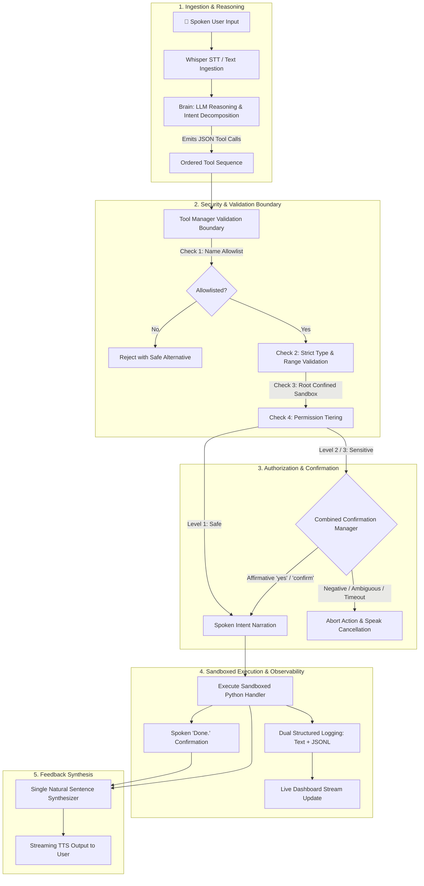

# 🤖 William-1 (v0.2) — Personal AI Voice Assistant & Safe System Controller

> **"From an AI that talks to an AI that can act — allowlisted, validated, observable, and strictly sandboxed."**

William-1 v0.2 elevates the personal voice assistant from a conversational chatbot into an intelligent system controller capable of safely executing real-world actions on your workstation. Operating strictly within **Phase 2 scope boundaries** (no unconstrained autonomous agent loops, no invasive GUI automation, no long-term vector memory), William-1 proves that agency and safety can coexist through strict validation, tiered confirmations, real-time action narration, and full auditability.

---

## 🌟 The William-1 v0.2 Experience

```text
 ┌─────────────────────────────────────────────────────────────────────────────┐
 │  USER: "Mute the computer and open YouTube."                                │
 │                                                                             │
 │  WILLIAM: "Muting system audio..."                                          │
 │  [OS Action: mute executed]                                                 │
 │  WILLIAM: "Done. Opening YouTube..."                                        │
 │  [OS Action: open_url('https://www.youtube.com') executed]                  │
 │  WILLIAM: "Done. I've muted your sound and opened YouTube in your browser." │
 └─────────────────────────────────────────────────────────────────────────────┘
```

### 1. ⚡ Multi-Tool Composition
Multi-intent requests (*"Open VS Code and my William-1 project"*, *"Mute the computer and open YouTube"*) automatically decompose into an ordered sequence of validated tool calls. If any step requires Level 2 or Level 3 authorization, William requests a **single combined confirmation** before acting, executes sequentially, and reports back in **one natural sentence**.

### 2. 🎙️ Spoken Action Narration
William never leaves you in silence while waiting for operations to finish. Using streaming TTS, William **announces intent before acting** (*"Opening Visual Studio Code..."*), performs the action, confirms completion (*"Done."*), and delivers natural final feedback.

### 3. 📊 Live System Dashboard (`python main.py --dashboard`)
Launch a real-time, terminal-based monitoring panel that visually demonstrates the **"every action is observable"** principle. The dashboard displays live CPU utilization, core counts, RAM usage, battery levels, primary storage capacity, and a live streaming feed of every executed action with its permission tier (`L1 SAFE`, `L2 SENSITIVE`, `L3 DESTRUCTIVE`) and status.

### 4. 🧠 Smart System Briefings
Ask *"How's my computer doing?"* or *"Give me a system health check"*, and William provides a synthesized health diagnosis instead of a raw stat dump. It analyzes RAM pressure, battery drain, and storage headroom, concluding with **one actionable observation**:
> *"Your computer is running well. Your battery is at 82 percent and charging, memory pressure is elevated at 88 percent with 0.9 gigabytes free, and your drive has 82 GB available. One observation: Memory pressure is high at 88 percent; closing inactive applications or background tabs will improve responsiveness."*

### 5. 🛡️ One-Command Safety Demo (`python main.py --safety-test`)
Demonstrate Phase 2 security guarantees in one automated command. The test suite walks a 7-point security gauntlet across app launching, file sandboxing, system telemetry, browser verification, confirmation enforcement, and deliberately dangerous requests (*"delete folder ../"* and *"shutdown"*), asserting:
- Path traversal rejection.
- Level 3 authorization boundaries and affirmative voice confirmation checks.
- Zero arbitrary command injection (`os.system` / raw shell execution is physically nonexistent).

### 6. 🔍 Total Tool Transparency ("What did you just do?")
Ask William *"What did you just do?"* or *"Explain your last action"*, and William reads back an exact, spoken audit from the action log. It clearly contrasts **what William said** from **what William actually executed on your operating system**:
> *"For your request 'Open VS Code and my William-1 project', what I announced was opening your project folder. What I actually did on your system was execute the open_folder tool for the William-1 workspace under Level 1 (Safe), which completed with status EXECUTED."*

### 7. 🛟 Graceful Degradation & Safe Alternatives
When an action fails or targets an unapproved application, William explains the exact failure and proactively offers the nearest safe alternative:
- Can't launch desktop Spotify? *"I couldn't launch Spotify -- want me to open it in the browser instead?"*
- Unapproved software requested? *"I don't have Photoshop in my approved applications -- want me to search for it on the web instead?"*
- Target file not found? Suggests searching your `Documents` directory.

### 8. 🧩 Clean Extensibility Showcase (`tools/template_tool.py`)
Architecture designed to scale cleanly toward Phases 3–5. Includes a reference tool (`get_system_uptime`), a structured blueprint for sensitive actions, and a 4-step checklist for contributing new tools.

---

## 📺 Live Dashboard & Terminal Preview

```text
========================================================================================
                         WILLIAM-1 v0.2 // SYSTEM CONTROLLER & DASHBOARD
========================================================================================
 [CPU]  Load: 14.2%  | Cores: 8 physical (16 logical)
 [RAM]  Used: 7.1 GB / 15.8 GB (45.1%) | Available: 8.7 GB
 [BATT] Level: 85% [AC POWER / CHARGING]
 [DISK] Used: 215.4 GB / 476.2 GB (45.2%) | Free: 260.8 GB
----------------------------------------------------------------------------------------
                               RECENT ACTIONS & AUDIT STREAM
----------------------------------------------------------------------------------------
 Time     Tool                Level            Status     Parameters / Summary
 17:15:02 mute                [L1 SAFE]        EXECUTED   mute=True
 17:15:03 open_url            [L1 SAFE]        EXECUTED   url="https://www.youtube.com"
 17:18:22 get_system_health   [L1 SAFE]        EXECUTED   Telemetry diagnosis synthesized
 17:19:40 delete_file         [L3 DESTRUCTIVE] BLOCKED    target="C:\Windows\System32"
========================================================================================
 Status: [LISTENING] Ready for voice commands... (Press Ctrl+C to exit)
```

---

## 🏗️ Security Architecture: The 7-Stage Pipeline

William-1 operates on an uncompromising security principle: **The AI model never touches the operating system directly.**



---

## 🔐 Permission Tiers & Security Rules

| Tier | Policy | Confirmation UX | Example Operations |
| :--- | :--- | :--- | :--- |
| **Level 1 (Safe)** | Auto-executes without interruption. Strictly read-only or low-impact reversibles. | Spoken intent narration $\to$ execution $\to$ *"Done."* | `get_system_health`, `open_application`, `open_url`, `search_files`, `mute`, `set_volume` |
| **Level 2 (Sensitive)** | Requires explicit confirmation. May interrupt workflow or discard unsaved state. | Clear verbal consequence warning + requires explicit affirmative response (*"yes"*, *"confirm"*). | `close_application`, `open_file` |
| **Level 3 (Destructive)** | High-impact system or state changes. Subject to the instant global kill-switch. | Explicit high-stakes consequence prompt + affirmative response. Instant kill-switch: `DISABLE_L3_TOOLS=True`. | `delete_file`, `lock_computer`, `sleep_system`, `restart_system`, `shutdown_system` |

### Security Invariants
1. **Zero Shell Execution**: `os.system`, `subprocess.Popen(shell=True)`, and raw terminal commands are physically absent from the tool layer.
2. **Path Traversal Shield**: Paths are resolved with `os.path.realpath` and checked against allowed directories (`Documents`, `Downloads`, `Desktop`, `Pictures`, `Music`, `Videos`, workspace root). Paths containing `..`, unauthorized drives, or system directories are rejected before execution.
3. **Dual Audit Trails**:
   - `logs/william_audit.log`: Human-readable chronological text log with timestamps.
   - `logs/william_actions.jsonl`: Machine-readable JSONL stream containing exact parameters, caller, execution status, elapsed time, and security levels.

---

## 🛠️ Complete Tool Registry (32 Allowlisted Tools)

| Category | Tool Name | Permission Tier | Platform | Description |
| :--- | :--- | :--- | :--- | :--- |
| **Applications** | `open_application` | Level 1 (Safe) | All | Opens an allowlisted app by name or alias; offers safe fallback if missing. |
| **Applications** | `close_application` | Level 2 (Sensitive) | All | Terminates running app process after explicit user confirmation. |
| **Browser** | `open_url` | Level 1 (Safe) | All | Opens allowlisted site alias or validated HTTPS URL. |
| **Browser** | `search_web` | Level 1 (Safe) | All | Conducts web search query in default browser. |
| **File Sandbox** | `open_folder` | Level 1 (Safe) | All | Opens sandboxed folder or project shortcut in File Explorer. |
| **File Sandbox** | `open_file` | Level 2 (Sensitive) | All | Opens sandboxed file in default app with confirmation. |
| **File Sandbox** | `list_directory` | Level 1 (Safe) | All | Lists files and subdirectories within permitted roots. |
| **File Sandbox** | `search_files` | Level 1 (Safe) | All | Searches files by name or extension in allowed directories. |
| **File Sandbox** | `get_file_info` | Level 1 (Safe) | All | Retrieves file size, modified timestamp, and type safely. |
| **File Sandbox** | `delete_file` | Level 3 (Destructive) | All | Deletes a file within permitted sandbox roots (requires affirmative consent). |
| **Telemetry & Health** | `get_system_health` | Level 1 (Safe) | All | Synthesized diagnostic briefing (RAM, CPU, battery, disk) + 1 actionable tip. |
| **Telemetry & Health** | `get_battery_status` | Level 1 (Safe) | All | Battery percentage, charging status, and remaining runtime. |
| **Telemetry & Health** | `get_cpu_usage` | Level 1 (Safe) | All | CPU utilization percentage and physical/logical core counts. |
| **Telemetry & Health** | `get_ram_usage` | Level 1 (Safe) | All | RAM usage in human gigabytes and percentage. |
| **Telemetry & Health** | `get_disk_usage` | Level 1 (Safe) | All | Primary storage capacity, used space, and free headroom. |
| **Telemetry & Health** | `get_os_info` | Level 1 (Safe) | All | Operating system name, build version, and platform architecture. |
| **Telemetry & Health** | `get_datetime` | Level 1 (Safe) | All | Current time, date, and day of week. |
| **Telemetry & Health** | `get_system_uptime` | Level 1 (Safe) | All | System boot timestamp and total uptime duration (Template showcase). |
| **Audit & Transparency** | `explain_last_action` | Level 1 (Safe) | All | Explains previous action from audit log: what was announced vs what was done. |
| **Audit & Transparency** | `get_recent_actions` | Level 1 (Safe) | All | Summarizes recent tool execution history with permission levels and status. |
| **System Controls** | `set_volume` | Level 1 (Safe) | Windows | Adjusts master system audio level (0 to 100). |
| **System Controls** | `mute` | Level 1 (Safe) | Windows | Mutes system audio output. |
| **System Controls** | `unmute` | Level 1 (Safe) | Windows | Restores system audio output. |
| **System Controls** | `lock_computer` | Level 3 (Destructive) | Windows | Locks Windows workstation (requires confirmation). |
| **System Controls** | `sleep_system` | Level 3 (Destructive) | Windows | Puts PC into low-power sleep mode (requires confirmation). |
| **System Controls** | `restart_system` | Level 3 (Destructive) | Windows | Restarts computer (requires explicit affirmative confirmation). |
| **System Controls** | `shutdown_system` | Level 3 (Destructive) | Windows | Powers off computer (requires explicit affirmative confirmation). |
| **Media Playback** | `play_pause` | Level 1 (Safe) | Windows | Toggles active media playback via virtual key events. |
| **Media Playback** | `next_track` | Level 1 (Safe) | Windows | Skips to next track. |
| **Media Playback** | `previous_track` | Level 1 (Safe) | Windows | Returns to previous track. |
| **Media Playback** | `volume_up` | Level 1 (Safe) | Windows | Increments master volume by 4%. |
| **Media Playback** | `volume_down` | Level 1 (Safe) | Windows | Decrements master volume by 4%. |

---

## 🧩 Developer Guide: Adding a New Tool

All tools adhere to the standard blueprint illustrated in `tools/template_tool.py`:

```python
# 1. Implement handler in tools/my_module.py
def get_ip_address(include_public: bool = False) -> dict:
    """Safe, structured function returning a standard dictionary."""
    return {
        "success": True,
        "message": "Your local IP address is 192.168.1.105.",
        "data": {"local_ip": "192.168.1.105"}
    }

# 2. Assign permission tier in security/permissions.py
TOOL_PERMISSIONS["get_ip_address"] = PermissionLevel.LEVEL_1_SAFE

# 3. Register schema in tools/tool_manager.py
self.register_tool(
    name="get_ip_address",
    func=get_ip_address,
    description="Retrieves local IP address information.",
    parameters={
        "include_public": {"type": "boolean", "description": "Whether to check public IP."}
    },
    required_params=[],
    type_specs={"include_public": bool},
    supported_platforms=["Windows", "Linux", "Darwin"],
)
```

The tool is instantly available to the LLM, validated at the security boundary, and audited in logs.

---

## 🧪 Verification & Automated Testing

William-1 includes two automated validation suites:

### 1. Safety & Security Test Suite (`python main.py --safety-test`)
Walks the 7-scenario safety testing plan:
```powershell
python main.py --safety-test
```
```text
============================================================
WILLIAM-1 v0.2 SAFETY TEST SUITE
============================================================
[PASS] 1. App Launch: Safe app allowed with proper L1 tier.
[PASS] 2. File Sandbox: Traversal blocked; valid search authorized.
[PASS] 3. System Briefing: Smart diagnostic synthesized with tip.
[PASS] 4. Browser URL: HTTPS verification passed; dangerous URI blocked.
[PASS] 5. Mute & Lock Controls: Mute executed at L1; lock computer enforced L3 confirmation.
[PASS] 6. Destructive Refusal (Delete Folder): Path traversal rejected and L3 blocked.
[PASS] 7. Dangerous Shutdown Refusal: Shutdown blocked by L3 kill-switch / affirmative check.
============================================================
ALL 7 SAFETY SCENARIOS PASSED
============================================================
```

### 2. Full Architecture Verification Suite (`python main.py --demo`)
```powershell
python main.py --demo
```
Verifies strict typing, psutil humanized units, fuzzy alias resolution, named shortcuts, affirmative confirmation filters, traversal defense, and JSONL logging.

---

## 🚀 Running William-1

| Mode | Command | Description |
| :--- | :--- | :--- |
| **Voice Assistant** | `python main.py` | Full microphone listening, streaming speech narration, and execution. |
| **Interactive Terminal** | `python main.py --text` | Fast text-based chat and tool execution testing. |
| **Live System Dashboard**| `python main.py --dashboard`| Full-screen Rich telemetry monitor with live streaming action table. |
| **Safety Gauntlet** | `python main.py --safety-test`| Automated demonstration of security boundaries and tiering. |
| **Diagnostics & Demo** | `python main.py --demo` | Verifies registry typing, sandboxing, and psutil telemetry. |

---

## 🗺️ Roadmap: The Journey Toward Autonomous Local AI

William-1 follows an intentional, phased engineering progression:

```
┌──────────────┐     ┌──────────────┐     ┌──────────────┐     ┌──────────────┐     ┌──────────────┐
│   Phase 1    │     │   Phase 2    │     │   Phase 3    │     │   Phase 4    │     │   Phase 5    │
│     TALK     │ ──> │     ACT      │ ──> │   REMEMBER   │ ──> │     SEE      │ ──> │  AUTONOMOUS  │
│ Voice & VAD  │     │ Safe Tools & │     │ Knowledge    │     │ Screen/Vision│     │   Local AI   │
│  Streaming   │     │  Dashboard   │     │ Graph Memory │     │ Automation   │     │   Agentic    │
└──────────────┘     └──────────────┘     └──────────────┘     └──────────────┘     └──────────────┘
   [Completed]         [Current v0.2]       [Next Phase]        [Planned]            [Vision]
```

- ✅ **Phase 1: Talk** — Smart VAD, low-latency streaming STT (Whisper), LLM conversational reasoning, and fluid TTS.
- ✅ **Phase 2: Act (v0.2)** — Hardened 32-tool registry, 3-tier security permissions, root-confined file sandboxing, live system dashboard, multi-tool composition, spoken action narration, tool transparency, and dual audit logging.
- ✅ **Phase 3: Remember (v0.3+)** — Trustworthy, controllable, privacy-safe persistent memory — preferences, project continuity, episodic summaries — all local SQLite with no cloud dependency.
- 🔜 **Phase 4: See & Traverse (Vision & Web)** — Multimodal screen understanding, visual inspection of active windows, authenticated browser task flows.
- 🔜 **Phase 5: Independence (Local AI & Agentic Workflows)** — Transitioning to on-device LLMs, autonomous sub-goal planning, and offline voice control.

---

## 🧠 Memory Architecture (v0.3+)

### Overview

William-1 v0.3+ ships a **trustworthy, controllable, privacy-safe** persistent memory layer backed by a local SQLite database. No vectors, no cloud embedding endpoints — just structured, auditable storage you fully control.

```
User utterance
      │
      ▼
  memory_policy.py      ← Credential/secret filter (hard block)
      │                 ← Sensitive-personal filter (soft block, needs confirmation)
      │                 ← Transient-phrase filter (greetings, commands skipped)
      ▼
  memory_manager.py     ← Normalize → Deduplicate (Jaccard) → Contradiction detect
      │
      ├─ Near-duplicate → Skipped (spoken: "I already have that")
      ├─ Contradiction  → Update existing record (spoken: "was X — now Y")
      └─ New fact       → Insert (spoken: "Got it, saved to preference memory")
      │
      ▼
  memory_store.py       ← SQLite WAL-mode parameterised transaction
      │
      ▼
  AuditLogger           ← Every save/update/delete → audit.log + actions.jsonl
```

### Database Schema

| Table | Purpose |
|---|---|
| `memories` | Personal facts, preferences, episodic notes |
| `projects` | Structured project state (status, stack, blocker, next task) |
| `project_events` | Chronological milestone / decision timeline |
| `conversation_summaries` | Concise session summaries (no raw transcripts) |
| `memory_settings` | Persistent settings flags (memory_enabled, top_k, local_only, …) |
| `schema_version` | Migration tracking |

**`memories` columns:** `id`, `category`, `content`, `source`, `created_at`, `updated_at`, `last_accessed_at`, `confidence`, `expires_at`, `deleted_at`, `is_deleted`

Soft-deletes (`is_deleted=1`) are used for `forget_memory` so the audit trail is never silently destroyed.

### Memory Lifecycle

```
Capture → Policy → Normalise → Deduplicate → Store → Expire/Cleanup
                                                         │
Retrieve ← Score (keyword + category + recency + confidence + access-recency)
         ← Token-budget cap (configurable, default 500 tokens ≈ 2000 chars)
         ← Cloud-transparency notice ("🔍 Recalled N memories → sending to LLM")
         ← local_only guard (blocks context from leaving machine)
```

**Scoring factors** (composite, descending sort):
1. Keyword match count × 2.5
2. Exact phrase bonus (+3.0)
3. Category match bonus (+2.0)
4. `confidence` multiplier (0.0–1.0)
5. Recency decay on `updated_at` (half-life ~14 days)
6. Access-recency bonus from `last_accessed_at`

### Memory Settings

All settings persist in the SQLite `memory_settings` table and survive restarts. They can also be set via `.env`:

| Setting | Default | Description |
|---|---|---|
| `memory_enabled` | `true` | Master on/off. When off, zero reads or writes. |
| `auto_capture` | `true` | Auto-detect facts/preferences from conversation |
| `confirm_before_save` | `false` | Ask before every save (privacy-first mode) |
| `retention_days` | `30` | Default episodic summary retention |
| `top_k` | `5` | Max memories injected into LLM prompt (1–10) |
| `max_token_budget` | `500` | ~Token budget for memory context block |
| `local_only` | `false` | Block memory content from leaving the machine |

Change at runtime: *"Turn on local-only memory mode"* → `configure_memory({"local_only": true})`

### Privacy Guarantees

**Hard-blocked (never stored, no override):**
- OpenAI / Anthropic / GitHub / AWS API keys
- Bearer tokens, JWTs, long hex/base64 credential blobs
- Private key PEM blocks
- Connection strings with embedded credentials
- Explicit `password =` / `api_key =` assignments
- Credit card numbers

William's spoken response: *"I won't store that — it looks like a credential. Passwords and keys must never be saved to memory."*

**Soft-blocked (stored only with explicit user confirmation):**
- Phone numbers, SSNs, passport/license numbers
- Full street addresses, dates of birth

**Transient phrases filtered automatically:**
- Greetings, time/date queries, single-word commands — never pollute persistent storage.

**Raw transcripts are NOT kept.** Only summaries generated at session end.

### Terminal UX Indicators

Every memory event prints a colour-coded indicator:

| Indicator | Meaning |
|---|---|
| `💾 Saved (preference): …` | New memory created |
| `✏️ Updated memory: was "…" → now "…"` | Contradiction resolved, old record updated |
| `🔍 Recalled N memories → sending to LLM context.` | Memory retrieved and injected |
| `🗑️ Forgotten N memory record(s) matching '…'` | Soft-deleted |
| `🔒 I won't store that — it looks like a credential` | Hard-blocked secret |
| `⚠️ Memory disabled.` | Operation skipped |
| `[Memory] local_only=true — memory context suppressed from cloud LLM.` | local_only active |

### Ambiguity Guard

Destructive commands (`forget that`, `update the project`) that match **multiple candidates across different categories** trigger a clarifying question:
> *"Which memory did you want to forget? I found 3: [1] (preference) I prefer Python…; [2] (fact) Python is a language…. Please say 'forget memory ID <number>'."*

William **never guesses** on destructive memory operations.

### Inspection & Control

```
# Voice commands
"Show me all my memories"          → show_all_memories() — grouped by category
"Show the William-1 project"       → show_project("William-1") — full record + timeline
"What are my memory settings?"     → get_memory_settings()
"Turn memory off"                  → set_memory_mode(False)
"Enable local-only mode"           → configure_memory({"local_only": True})
"Forget that I prefer Python"      → forget_memory("Python")
"Forget memory ID 7"               → forget_memory_by_id(7)
```

### Backup / Restore

```python
# Export non-sensitive memories to JSON (sensitive memories excluded automatically)
memory_manager.export_memories()
# → data/william_memory_export_20261012_214500.json

# Restore from backup (requires explicit confirmation)
memory_manager.import_memories("data/william_memory_export_20261012_214500.json", confirmed=True)
```

**Exported format:**
```json
{
  "exported_at": "2026-10-12T21:45:00",
  "version": "v0.3+",
  "memories": [...],
  "projects": [...],
  "conversation_summaries": [...]
}
```

Sensitive memories (credentials, etc.) are **automatically excluded** from exports.

### Cloud Transparency

When memory context is about to be sent to a cloud LLM:
1. Only the **retrieved snippets** (top-K, token-budget capped) go — not the full DB.
2. The terminal prints: `🔍 Recalled N memories → sending to LLM context.`
3. Set `MEMORY_LOCAL_ONLY=True` in `.env` (or voice: *"Enable local-only mode"*) to block all memory from leaving the machine. When active, the terminal prints: `[Memory] local_only=true — memory context suppressed from cloud LLM.`

### Running the Test Suite

```bash
# Activate virtual environment first
.venv\Scripts\activate  # Windows
source .venv/bin/activate  # macOS/Linux

pip install pytest
pytest tests/test_memory.py -v
# Expected: 51 passed
```

Tests cover: persistence across restart · natural-language retrieval · update/contradiction · deduplication · delete · deleted-not-retrieved · memory-disabled mode · corrupted/missing DB recovery · retention/expiry · settings persistence · ambiguity guard · export/import round-trip · confirm_before_save · local_only · policy unit tests · secret rejection.

